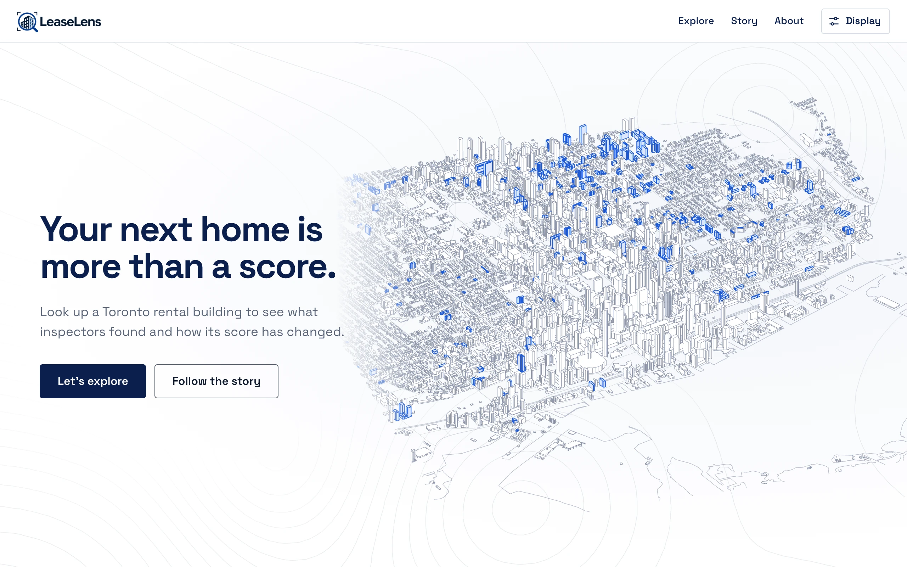
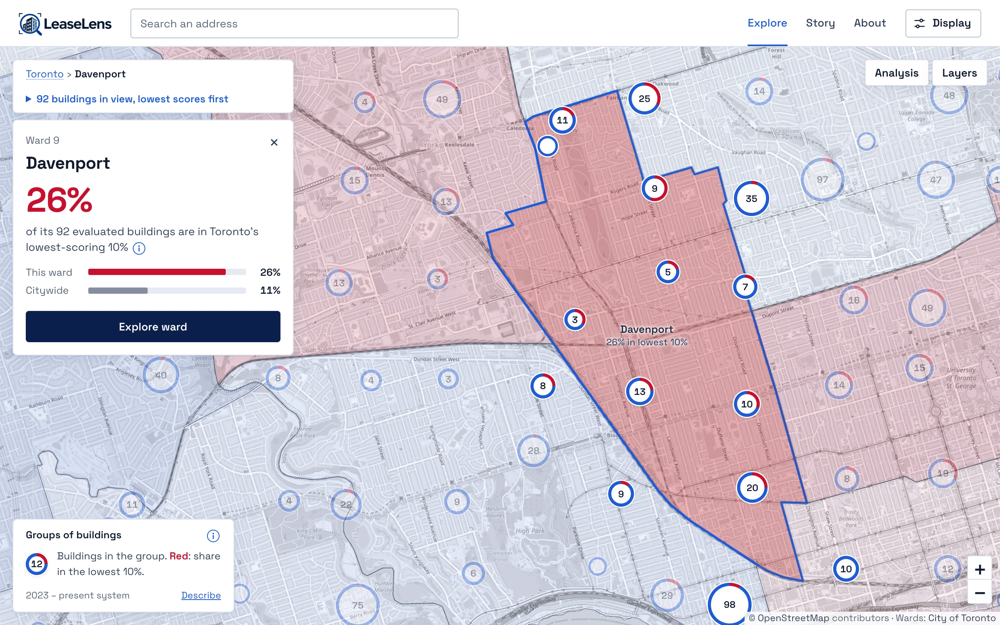
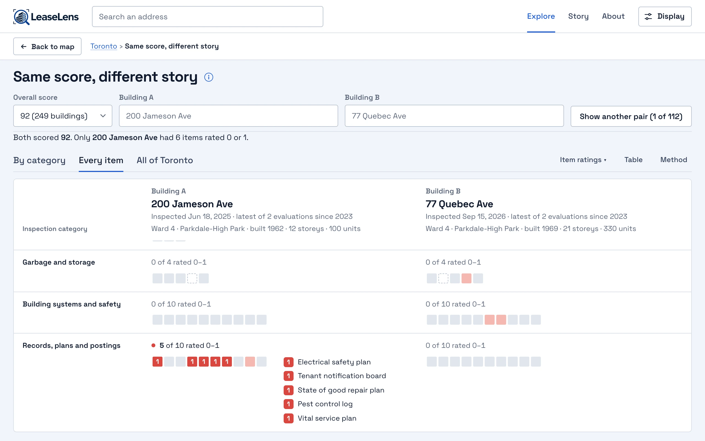
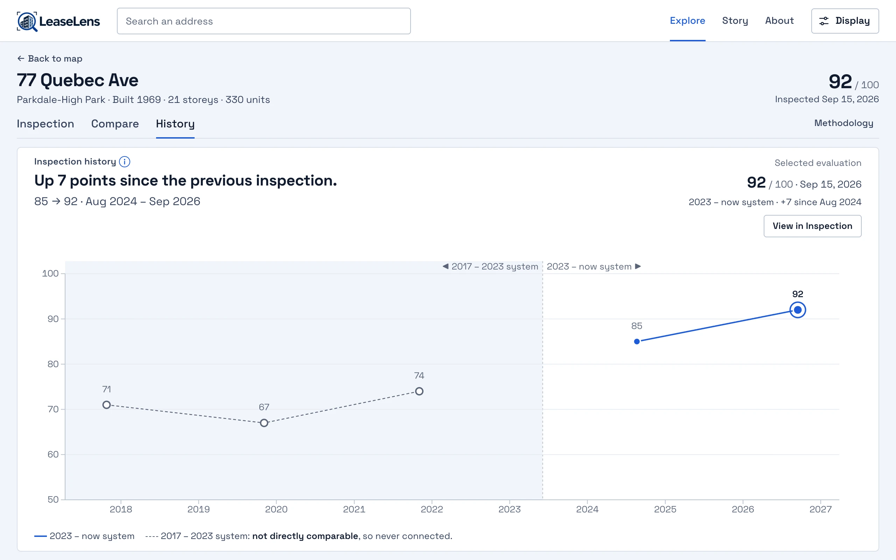
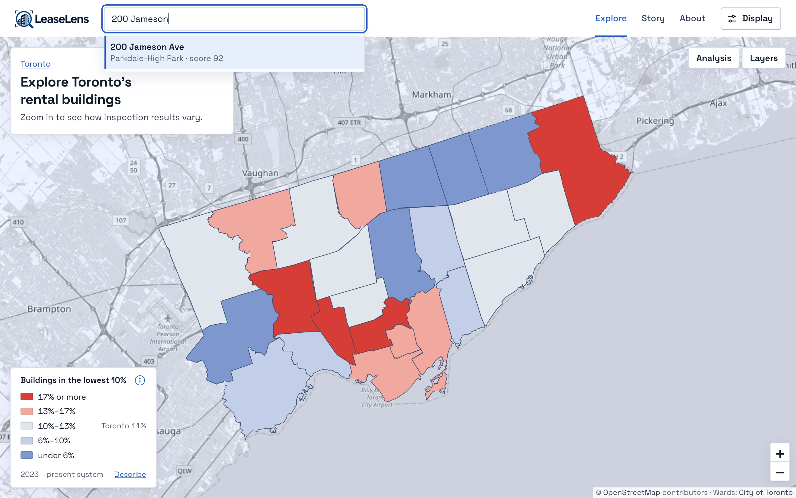
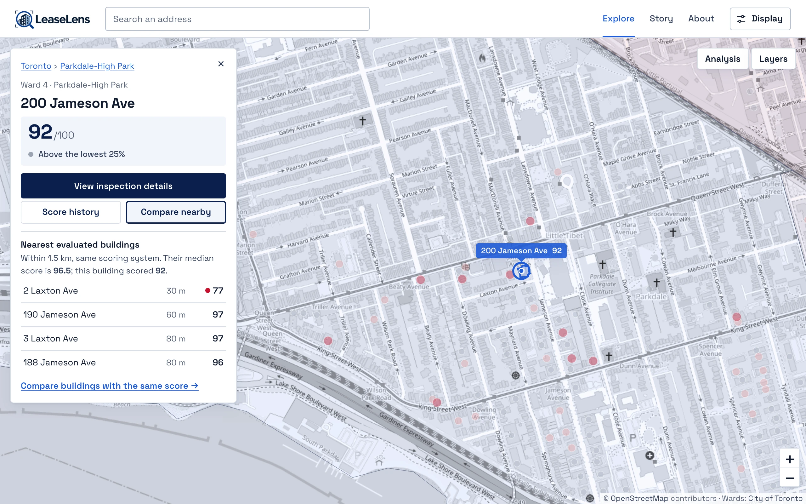
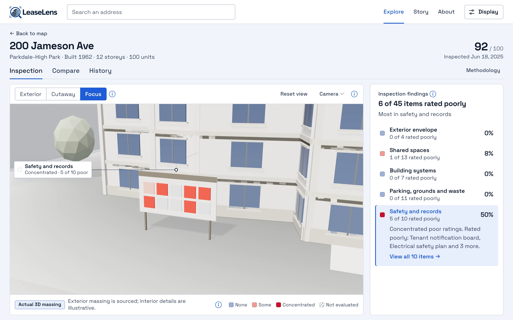
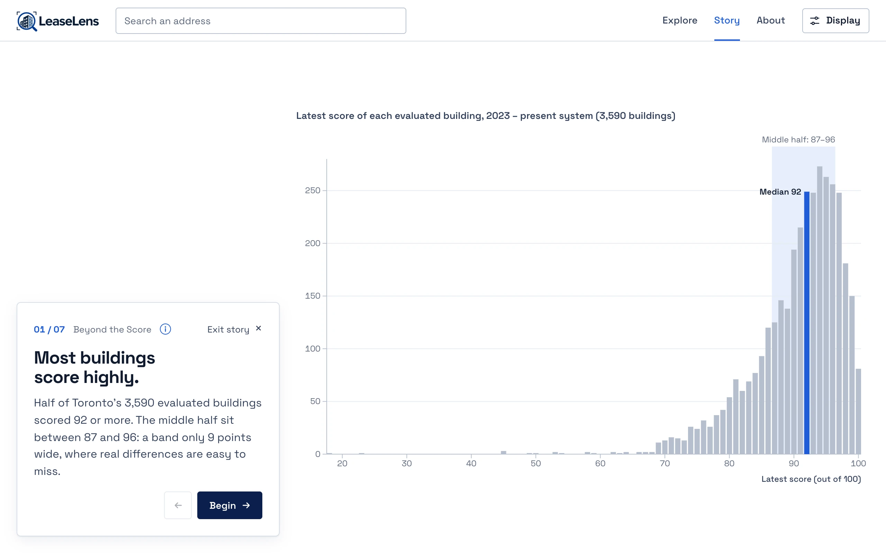
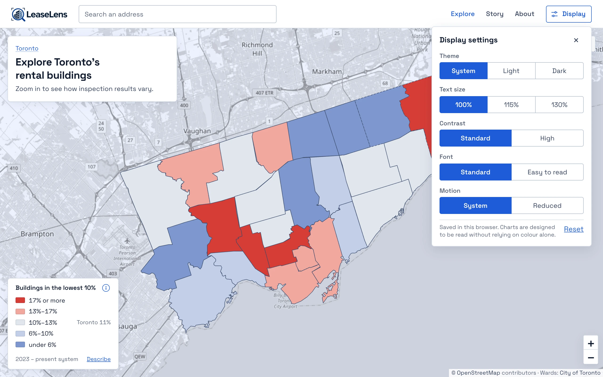

# LeaseLens

A visual guide to Toronto rental building inspections, built for CSC316: Data Visualization at the University of Toronto.

**Created by** Reena Obmina, Tess Madison, and Hargun Badhesha  
**Dataset** City of Toronto RentSafeTO apartment building evaluations

### [▶ Open LeaseLens: lease-lens-flame.vercel.app/dashboard](https://lease-lens-flame.vercel.app/dashboard/)


*The LeaseLens homepage. Rental buildings that the City has inspected are drawn in blue.*

| Looking for… | Go to |
|---|---|
| The website | [lease-lens-flame.vercel.app/dashboard](https://lease-lens-flame.vercel.app/dashboard/) |
| What LeaseLens shows | [The data story](#the-data-story) and [Features](#features) |
| How to run the code | [How to run LeaseLens](#how-to-run-leaselens) |
| Libraries used | [Libraries used](#libraries-used) |
| The data and what each column means | [Data](#data) and [data/README.md](data/README.md) |
| Where the code lives | [Project folders](#project-folders) |

## What is LeaseLens?

When you rent an apartment in Toronto, the City may have inspected the building. Its **RentSafeTO** program checks apartment buildings with three or more storeys or 10 or more units, and gives each one a score out of 100.

LeaseLens helps first-time renters look past that single number. You can search for a building and see where it sits in the city. You can see what the inspectors actually found, and how its score has changed over time.

## The data story

**Your next home is more than a score.**

Most buildings score highly. Half of the 3,590 buildings inspected under the current system scored 92 or more, and the middle half scored between 87 and 96. When so many scores are close together, the number alone doesn't tell you much. LeaseLens shows three things the score hides.

### 1. Where you look matters


*Davenport selected on the map. Red areas have more low-scoring buildings than average; blue areas have fewer.*

Low scores are not spread evenly across Toronto. LeaseLens marks a building as being in the city's **lowest-scoring 10%** if its latest score is 81 or below. Because many buildings are tied at 81, this group is 11% of all buildings.

- In **Davenport**, 24 of 92 buildings (**26%**) are in that group, more than twice the city average.
- In **Don Valley West**, only 5 of 170 (**3%**) are.

These figures compare the 21 wards that have at least 50 inspected buildings.

**Takeaway:** compare a building with its own neighbourhood, not just with the whole city.

### 2. The same score can hide different issues


*Two buildings with the same score, compared item by item. Each square is one inspected item. Red squares were rated low.*

**200 Jameson Ave** and **77 Quebec Ave** are in the same ward, and both scored **92**. But inspectors found different things.

- At **200 Jameson Ave**, 6 items were rated low (1 out of 3). Five were records the landlord must keep or post: the electrical safety plan, tenant notification board, state of good repair plan, pest control log and vital service plan. The sixth was the hallway walls and ceilings.
- At **77 Quebec Ave**, no items were rated low.

**Takeaway:** the same score can describe very different buildings. Look at what was inspected, not just the number.

### 3. One inspection is a snapshot


*Score history for 77 Quebec Ave. Scores from the old and new systems are shown side by side but never joined.*

Scores change from one inspection to the next. **77 Quebec Ave** went from **85** in August 2024 to **92** in September 2026. Across the city, a building's next score was higher 64% of the time and lower 29% of the time. That's based on 3,216 pairs of back-to-back inspections.

**Watch out for the 2023 change.** The City changed how it scores buildings in 2023:

| | Before 2023 | Since 2023 |
|---|---|---|
| What is rated | 20 categories | Up to 50 items |
| Rating scale | 1 to 5 | 1 to 3 (0 if an item couldn't be inspected) |

Because the two systems measure different things, their scores can't be compared directly. LeaseLens shows older scores as a separate dashed line and never connects them to newer ones.

**Takeaway:** check whether a building's latest score continues a trend or breaks one, and compare scores only within the same system.

> **Good to know.** Scores describe a building's shared areas (lobbies, hallways, grounds, records) on the day of the inspection. They don't describe individual apartments, rents or landlords. A high score doesn't prove a building is safe, and a low one doesn't prove it is unsafe. The data in this project covers inspections from September 2017 to September 2026. Read more on the website's [About page](https://lease-lens-flame.vercel.app/dashboard/#/about) under *Data & methodology*.

## Features

Each feature lists what a renter can use it for. All screenshots show the real website with real City data.

### Explore and address search

**Use it to:** find a building you're considering and see its score in context.


*Start typing an address. Each suggestion shows the building's ward and latest score.*

The map starts with Toronto's 25 wards. Zoom in to see groups of buildings, then single buildings. The ward view appears in [Where you look matters](#1-where-you-look-matters).

### Building summary and Compare Nearby

**Use it to:** see how a building compares with others close by.


*200 Jameson Ave scored 92, lower than the typical score of 96.5 for buildings within 1.5 km.*

Click a building to open its summary card. From there you can view the full inspection, its score history, or nearby buildings.

### Building X-Ray

**Use it to:** pick an inspection category and see which items were rated low.


*The X-Ray for 200 Jameson Ave, focused on "Safety and records": 5 of its 10 items were rated low.*

The X-Ray shows one inspection on a 3D model of the building. Choose **Exterior**, **Cutaway** or **Focus** to look around. The building's outline and height are real, from City data. **The inside of the building is for illustration only.** It is not a floor plan, and it doesn't show where problems were found.

### Same Score, Different Story

**Use it to:** compare two buildings with the same score, item by item.

Pick a score to see pairs of buildings that share it, or type in two addresses yourself. For example, 249 buildings scored 92. Three tabs show the pair in more or less detail: **By category**, **Every item** and **All of Toronto**. A screenshot appears in [The same score can hide different issues](#2-the-same-score-can-hide-different-issues).

### Score History

**Use it to:** check whether the latest score is part of a pattern or a sudden change.

Open it from any building's summary card, or from the **History** tab in the X-Ray. It plots every inspection and says how much the score changed since the last one. A screenshot appears in [One inspection is a snapshot](#3-one-inspection-is-a-snapshot).

### Guided Story

**Use it to:** get a short, step-by-step introduction to what the data shows.


*Chapter 1 of 7: most scores sit in a narrow band near the top.*

The story, *Beyond the Score*, walks through the city, one ward, one building, a comparison and a score history in seven chapters. Every number in it is calculated from the data when the page loads.

### Display settings

**Use it to:** make the website easier to read.


*Choose light or dark mode, larger text, higher contrast, an easier-to-read font, or less motion.*

Your choices are saved in your browser. Charts don't rely on colour alone, so they can be read with any colour vision.

## How to run LeaseLens

### The easy way: use the website

Open **[lease-lens-flame.vercel.app/dashboard](https://lease-lens-flame.vercel.app/dashboard/)** in any up-to-date browser (Chrome, Firefox, Safari or Edge). There's nothing to install.

### Run it on your own computer

LeaseLens is a plain website: HTML, CSS and JavaScript files with no build step. You only need to serve the folder with a small local web server.

**You need**
- **Python 3**, to run the local web server. Check by typing `python3 --version` in a terminal (`python --version` on Windows).
- **An internet connection.** The map tiles, fonts and the D3, Leaflet and Three.js libraries load from the internet.

**Steps**

1. **Get the code.** Download this repository as a ZIP from GitHub (green **Code** button → **Download ZIP**) and unzip it. Or clone it:
   ```sh
   git clone https://github.com/rmobmina/lease-lens.git
   ```
2. **Open a terminal in the project folder,** the folder that contains `dashboard`, `data` and `shared`:
   ```sh
   cd lease-lens
   ```
3. **Start the web server:**
   ```sh
   python3 -m http.server 8000
   ```
   On Windows, use `python -m http.server 8000`.
4. **Open <http://localhost:8000/dashboard/>** in your browser.
5. **To stop the server,** go back to the terminal and press `Ctrl + C`.

**If something goes wrong**
- *"Couldn't load the data"*: start the server from the main project folder, not from inside `dashboard`. Also open the page through `http://localhost:8000/...`, not by double-clicking the HTML file. Browsers block data loading from files opened directly.
- *Port 8000 is already in use*: use another number, such as `python3 -m http.server 8080`, then open `http://localhost:8080/dashboard/`.

### Optional: run the tests

The tests check the site's numbers against the real data. They need **[Node.js](https://nodejs.org/)** 18 or newer; we used Node 22.

```sh
npm install     # one time: installs D3 for the tests
npm test        # runs the tests
npm run check   # checks that every JavaScript file the site loads is valid
```

### Optional: rebuild the processed data

The map boundaries, 3D building shapes and homepage drawing are already built and saved in `dashboard/data/`. To rebuild them, download the original City files into `data/raw/` (see [data/README.md](data/README.md#other-data-the-site-uses)). Then run the scripts in `scripts/`, for example `python3 scripts/build_massing.py`. The scripts use only Python's standard library, so there's nothing extra to install.

## Libraries used

LeaseLens doesn't use a framework or a build tool. The website loads these libraries directly from public CDNs, so nothing needs installing.

| Library | Version | What it does in LeaseLens | Licence |
|---|---|---|---|
| [D3.js](https://d3js.org/) | 7.9.0 | Reads the CSV data and draws the charts: score history, comparisons, story charts | ISC |
| [Leaflet](https://leafletjs.com/) | 1.9.4 | The interactive map: wards, building groups and buildings | BSD 2-Clause |
| [Three.js](https://threejs.org/) | 0.160.0 | The 3D Building X-Ray, including its `OrbitControls` and `RoomEnvironment` add-ons | MIT |
| [OpenStreetMap](https://www.openstreetmap.org/copyright) map tiles | — | The background street map | © OpenStreetMap contributors (ODbL) |
| [Space Grotesk](https://fonts.google.com/specimen/Space+Grotesk) and [Atkinson Hyperlegible](https://fonts.google.com/specimen/Atkinson+Hyperlegible) | via Google Fonts | The site's typeface (Space Grotesk), and the "Easy to read" option in Display settings (Atkinson Hyperlegible) | SIL Open Font License |

**Development tools.** These are not needed to view the site.
- **Node.js** with its built-in test runner, and **D3** from npm (`d3` ^7.9.0, in `package.json`), for the automated tests.
- **Python 3** standard library only, for the scripts in `scripts/` that prepare the map, 3D and homepage data.

## Data

All data comes from **City of Toronto Open Data**, under the [Open Government Licence – Toronto](https://open.toronto.ca/open-data-licence/).

| File | What it is |
|---|---|
| [`data/apartment_building_evaluations_pre_2023.csv`](data/apartment_building_evaluations_pre_2023.csv) | 11,760 inspections from 2017 to May 2023 (old scoring system) |
| [`data/apartment_building_evaluations_2023_current.csv`](data/apartment_building_evaluations_2023_current.csv) | 6,806 inspections from June 2023 to September 2026 (current scoring system) |

- **What every column means:** [data/README.md](data/README.md)
- **How the data is cleaned and combined** (for example, matching buildings across both files, and handling blanks and N/A): [docs/data-notes.md](docs/data-notes.md)
- **Original source:** [Apartment Building Evaluations (RentSafeTO)](https://open.toronto.ca/dataset/apartment-building-evaluation/)

## Project folders

```
lease-lens/
├── dashboard/        The website
│   ├── index.html    The single page that holds every view
│   ├── css/          Styles: colours, type, layout (light and dark themes)
│   ├── js/           The app's code
│   │   ├── main.js       Starts the app, handles navigation between views
│   │   ├── model.js      Turns the inspection records into scores, rankings and comparisons
│   │   ├── atlas/        The Explore map and address search
│   │   ├── home/         The homepage drawing
│   │   ├── sections/     Each view: building card, X-Ray, comparison, analysis panels
│   │   ├── story/        The guided story, Beyond the Score
│   │   └── xray/         The 3D Building X-Ray
│   └── data/         Processed map, 3D and homepage data
├── shared/js/        Loads and cleans the two CSV files (used by the dashboard and the tests)
├── data/             The RentSafeTO CSV files and their field guide
├── scripts/          Python scripts that prepare the processed data
├── tests/            Automated tests, run against the real data
├── story/            An earlier prototype chapter (score changes over time)
└── docs/             Design notes, data notes and screenshots
```

Each code file starts with a comment explaining what it does. For more detail on the design and the 3D model, see [docs/civic-redesign.md](docs/civic-redesign.md) and [docs/building-xray.md](docs/building-xray.md).

## Credits

**Team:** Reena Obmina, Tess Madison and Hargun Badhesha, for CSC316: Data Visualization at the University of Toronto.

**Data** from City of Toronto Open Data, under the [Open Government Licence – Toronto](https://open.toronto.ca/open-data-licence/):
- [Apartment Building Evaluations (RentSafeTO)](https://open.toronto.ca/dataset/apartment-building-evaluation/): every score and item rating
- [3D Massing](https://open.toronto.ca/dataset/3d-massing/): building outlines and heights for the X-Ray and homepage
- [City Wards](https://open.toronto.ca/dataset/city-wards/): ward boundaries
- [Toronto Centreline](https://open.toronto.ca/dataset/toronto-centreline-tcl/): streets in the homepage drawing

**Base map:** © [OpenStreetMap](https://www.openstreetmap.org/copyright) contributors.

LeaseLens is an independent student project. It is not an official City of Toronto service. The code is released under the [MIT License](LICENSE).
