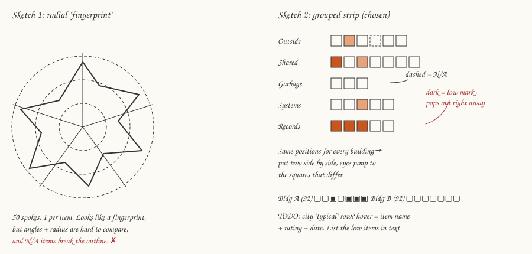
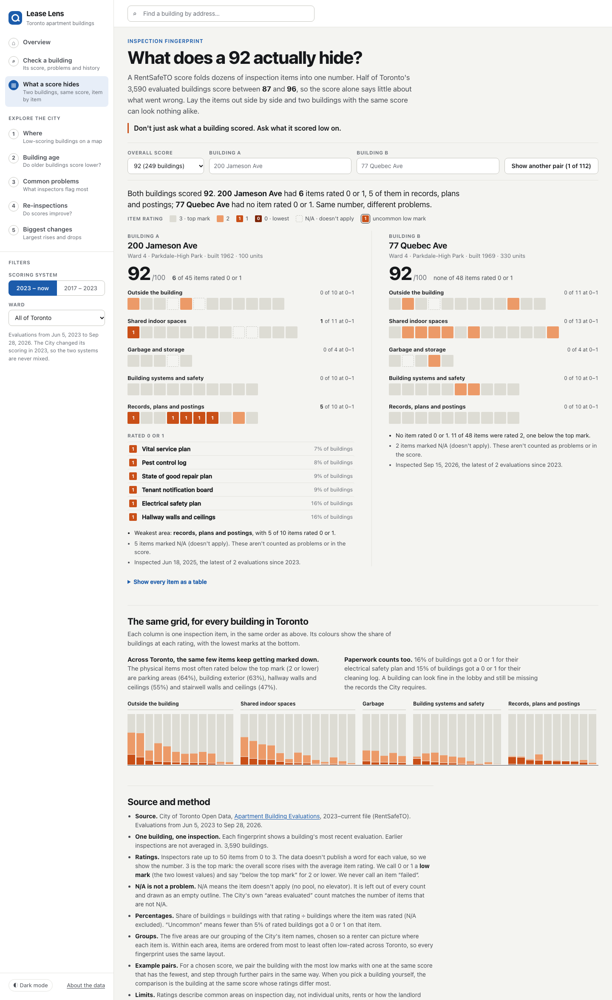
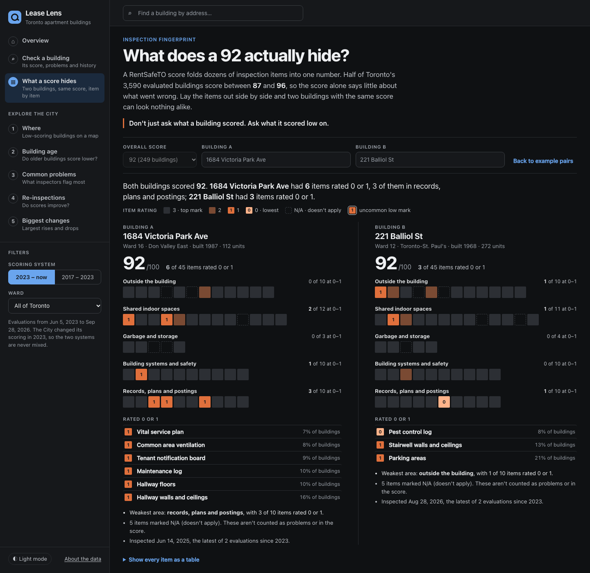

# Process book: Inspection fingerprint (novel view)

Live view: `dashboard/#/fingerprint` (or `#/fingerprint/<RSN>` for a specific building).
Code: `dashboard/js/fingerprint-model.js` (data) and `dashboard/js/sections/fingerprint.js` (drawing and interaction).

## 1. Design question

> When two Toronto apartment buildings get the same RentSafeTO score, do they have the same problems?

Our audience is first-time renters. RentSafeTO scores are high and tightly packed. In the 2023–current system, half of the 3,590 evaluated buildings score between 87 and 96 (median 92). A renter who compares buildings by score alone is comparing numbers that barely differ. Each score is built from up to 50 item ratings, though, and those ratings can be very different underneath. We want a view that makes a renter think: *I shouldn't just ask what a building scored. I should ask what it scored low on.*

## 2. Checking the data before designing

We checked these against `data/apartment_building_evaluations_2023_current.csv` before choosing any wording:

| Question | What we found | How the view handles it |
|---|---|---|
| Rating scale and direction | Values are `0`, `1`, `2`, `3` or `N/A`. The proactive score closely follows 100 × mean rating ÷ 3 (most rows within ±2 points), and mean item rating correlates with the overall score at r = 0.97. **3 is the top mark.** | Ratings are shown as numbers ("rated 1 of 3"). The City's open-data page doesn't publish a word for each value, so we never use "failed" or "poor". |
| What N/A means | `NO OF AREAS EVALUATED` equals the number of non-N/A items in all 6,806 rows. N/A = not assessed / doesn't apply (no pool, no elevator). | N/A is drawn as an empty dashed outline and left out of every count and denominator. It is never treated as a low mark. Blank (none in the current file) is drawn separately as "not recorded". |
| Unit of the ratings | One row = one building on one inspection date. Most buildings have 2 evaluations since 2023. | Each fingerprint uses the building's **latest** evaluation (the same rule as the rest of the dashboard). We don't average across inspections, because averaging would produce ratings that never happened. The tooltip and notes give the inspection date. |
| Denominators | Items differ a lot in how often they apply (pools: N/A in 93% of rows; retaining walls: 53%). | Every share = buildings with that rating ÷ buildings where the item was rated. |

**Corrections to our earlier findings.** Re-computing them showed that some of our wording needed to change:

| Earlier finding | Verified value (latest evaluation per building) | Correct wording |
|---|---|---|
| Parking areas 64%, building exterior 63%, hallway walls/ceilings 55%, stairwell walls 47% | 63.8%, 62.5%, 54.9%, 47.4% | Share rated **2 or lower** (below the top mark). They are not "failed": most of these are 2s. Only 20%, 15%, 16% and 13% got a 0 or 1. |
| ~16% lowest rating for electrical safety plan | 15.8% rated 0 or 1; only **1.6%** rated 0 | "got a 0 or 1 (the two lowest marks)", not "the lowest rating" |
| ~15% lowest rating for cleaning log | 14.9% rated 0 or 1; 1.3% rated 0 | same as above |
| Bottom 10% have ~31 units vs 51 overall | Median 31 vs 51 (bottom 10% = latest score ≤ 81). The means are 74 vs 91. | Say "median"; this finding isn't used in the fingerprint |

All the numbers in the view are calculated from the CSV when the page loads. None are typed in.

## 3. Early sketch

*Digitized from our concept sketches. Replace with a scan of the hand-drawn page for submission.*

We started with a **radial "fingerprint"**: 50 spokes, one per item, with the radius showing the rating. The name and the shape were appealing. We dropped it because:
- comparing two radar shapes depends on judging angle and area, which people do poorly;
- N/A items leave gaps in the outline, which then reads as a dip (a false problem);
- item labels don't fit around a 50-spoke circle on a phone.

## 4. Visual encoding rationale

**Form: a grouped strip of squares, one square per inspection item, on the same grid for every building.**

| Channel | Encodes | Why |
|---|---|---|
| Position (row) | Area of the building: outside, shared indoor spaces, garbage and storage, systems and safety, records and postings | Five groups a renter can picture during a viewing. The grouping is ours, based on the City's item names; every one of the 50 items is assigned once, and the code checks this. |
| Position (within row) | The item, in a fixed order: most often low-rated across Toronto first | The same item is always in the same spot, so two fingerprints can be compared square by square. Commonly weak items cluster at the left, so a low mark further right is more unusual. |
| Colour (one orange hue, light → dark) | Rating 3 → 2 → 1 → 0 | A sequential ramp: the lower the mark, the more it stands out. The 3s fade into the page so the problems show first. Checked with a colour-vision-deficiency validator in light and dark mode. |
| Digit inside the square | Rating, for 0 and 1 only | Low marks don't rely on colour alone. |
| Dark outline ring | "Uncommon" low mark: rated 0–1 on an item where fewer than 5% of buildings get that low | Points out what's actually unusual about this building, not just what's common everywhere. |
| Dashed empty outline | N/A | Visibly *not* a problem, and it doesn't look like a low mark. |

**Why this beats a table.** A table of 50 rows × 2 buildings makes the reader scan every number. In the strip, the eye goes straight to the dark squares, and because the layout is fixed, "same score, different problems" shows up in the first second. The full table is still there for screen readers and anyone who wants it ("Show every item as a table").

**Toronto overview.** The same grid is repeated for all buildings, with each square stretched into a 100% column of rating shares (lowest marks at the bottom). It uses the same colours as the building view, so no new legend is needed. It gives the baseline: some items (parking, exterior) are often marked down everywhere, while others (elevator maintenance, pests) rarely are.

**Annotations, not just tooltips.** Each building gets: a one-line comparison ("Both buildings scored 92. … had 6 items rated 0 or 1 …; … had none"), group counts written next to each row ("5 of 10 at 0–1"), the low-rated items listed by name with how common that mark is citywide, the weakest area, uncommon items, N/A counts and the inspection date. The Toronto overview has two short notes whose numbers are calculated from the data.

## 5. Interaction design

- **Story entry.** The view opens on "What does a 92 actually hide?" with a real pair of buildings: both scored 92 (the median), one with the most items rated 0–1 and one with the fewest. The home page links to it, and so does every building report ("See its inspection fingerprint →").
- **Choose a score.** A dropdown lists every score that at least two buildings share. "Show another pair" steps through further pairs at that score, in the same most-vs-fewest order.
- **Choose buildings.** Search boxes for Building A and B use the same address list as the main search. Picking only A selects as B the building with the same score whose ratings differ most. The URL updates (`#/fingerprint/<RSN>`) so a comparison can be shared.
- **Hover / focus.** Tooltip: item name (plain-language label and the City's own name), area, rating, inspection date, and how often Toronto buildings get that mark. Hovering an item highlights **the same item in both buildings and in the Toronto chart** (linked highlighting).
- **Keyboard.** Each chart is one Tab stop; arrow keys move between items (↑/↓ jump between rows), Home/End go to the first and last item. A live region announces each item for screen readers.
- **Motion.** The only animation: when the building changes, each square fades from its old rating colour to its new one (380 ms), which shows what changed. It's turned off under `prefers-reduced-motion`.
- **Filters.** The ward filter limits the example pairs and the Toronto overview to that ward. The grid order and the "uncommon" threshold always use all of Toronto, so a building's fingerprint looks the same under any filter. The 2017–2023 system isn't supported (different items and a 1–5 scale); the view says so and offers to switch.

## 6. Prototype V1

Building-to-building comparison is fully working in V1. It isn't a mockup.

## 7. What changed from the sketch

- **Radial → grouped strip** (reasons above).
- **Computed pairs, not hand-picked ones.** The sketch showed a single pair of buildings. V1 picks pairs by a stated rule, so anyone can reproduce the example and step through 100+ other pairs.
- **"Poor" → numbers.** Checking the data showed that the "low-rated" percentages in our findings counted any 2 as low. We now separate "rated 2 or lower" (below the top mark) from "rated 0 or 1" (low mark), and we dropped "poor/failed" wording.
- **Added the "uncommon" ring.** Parking and the exterior are marked down in most buildings, so on their own they say little about a particular building. The ring points to the low marks that are actually unusual.
- **Added the Toronto overview** (the sketch's "city typical row?" note) as a separate chart using the same grid, instead of a third row squeezed under each building.
- **Added the item list and table.** Tooltips alone hid the item names. The low items are now listed under each fingerprint.

## 8. Limitations and V2 improvements

**Limitations**
- Ratings describe common areas on inspection day. They say nothing about individual units, rent or how quickly the landlord fixes things.
- Only the latest evaluation is shown. A building that improved (or got worse) since its previous inspection looks the same as one that didn't change.
- The five areas are our grouping. Other groupings are possible (for example, by who is responsible for the fix).
- The City doesn't publish item weights. We don't claim how much each item moves the score; the score is the City's own.
- The "uncommon" threshold (5%) is a design choice and is stated on the page.
- The 2017–2023 system isn't covered.

**V2**
- **Change over time:** show the previous evaluation as a faint second layer, or toggle between inspections, so a renter can see whether problems were fixed.
- **Compare with what you're considering:** keep a short list of buildings (2–4) as small multiples, not just a pair.
- **Peer baseline:** compare against buildings of similar age and size, not all of Toronto.
- **Pre-2023 fingerprint** using the 20 old categories on the 1–5 scale, shown as a separate panel and never mixed with the current system.
- **Print / share card:** a one-page fingerprint a renter can bring to a viewing, with the questions to ask ("Can I see the electrical safety plan?").
- User test the five groupings and the 0–1 / 2 wording with first-time renters.
