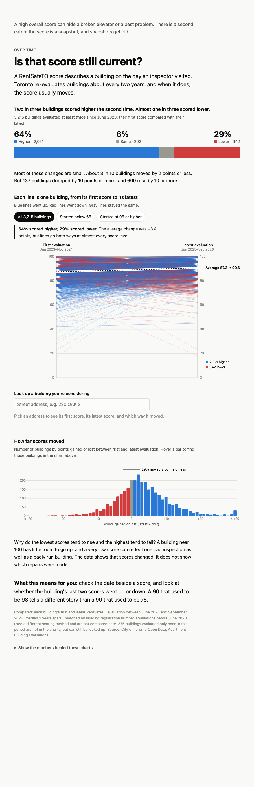
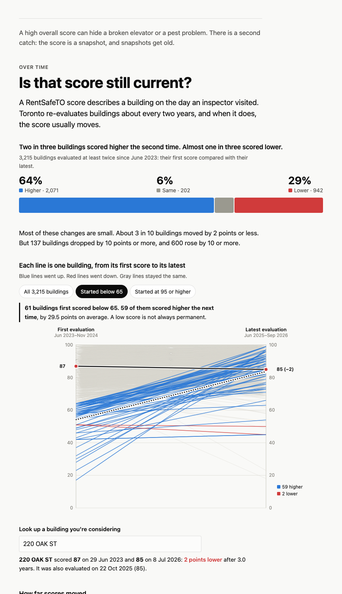
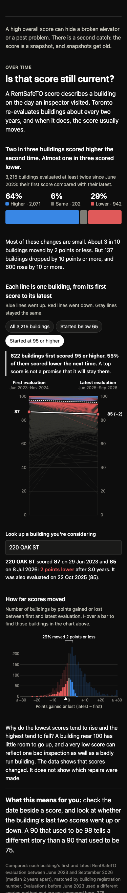

# Temporal chapter — "Is that score still current?"

Process-book entry for the LeaseLens temporal view (Prototype V1, option A: functional D3 view).

- **Run it:** `python3 -m http.server 8000` from the repo root, then open http://localhost:8000/story/temporal.html
- **Deep links:** `?mode=all|low|high` and `?rsn=<RSN>`. Example: `?mode=low&rsn=4155602` (used for screenshots).
- **Check the numbers:** `python3 scripts/validate_temporal.py`. Exits non-zero if any quoted figure drifts. The page also runs the same checks in the browser (console table, `body[data-validation]`).

| File | Role |
|---|---|
| `story/temporal.html` | Chapter markup + all website copy |
| `story/js/temporal-data.js` | Transformation only: records → one change row per building, summaries, audit, validation |
| `story/js/temporal-chart.js` | Rendering and interaction only |
| `story/css/temporal.css` | Reading typography + direction colours (layered on `explorer/style.css`) |
| `scripts/validate_temporal.py` | Independent stdlib re-derivation of every quoted number |
| `docs/img/temporal-*.png` | Screenshots for the process book |

Reused without modification: `explorer/js/data.js` (`LL.loadAll` cleaning, RSN matching, flags), `explorer/js/charts.js` (tooltip, number formats, deterministic hash), and `explorer/style.css` (colour tokens, tooltip, axis and gridline styles, dark mode).

---

## 1. Analytical question

**Can renters trust one RentSafeTO score over time?** Concretely: *what happened between a building's earlier and latest evaluation?*

## 2. Data definitions and validation

| Decision | Definition |
|---|---|
| Same building | Same **RSN** (registration number). Never matched by address, because 4 RSNs change address text across files. |
| Period compared | **2023–current file only** (Jun 2023 – Sep 2026). Pre-2023 scores use a different method (20 categories rated 1–5 vs 50 rated 0–3; median 74 vs 91). |
| First evaluation | Earliest `EVALUATION COMPLETED ON` for the RSN in that file |
| Latest evaluation | Most recent date for the RSN |
| Eligible | ≥ 2 evaluations with a score and a date |
| Direction | sign(latest − first). "Same" means exactly equal. |
| Change | latest − first, in points (0–100 scale) |

**Why the period restriction matters.** Mixing the two files gives "97.7% of buildings improved, +23.8 on average". That number mostly measures the methodology change, not the buildings. The chapter must never compare across 2023.

**Validation results** (all reproduced exactly):

| Check | Result |
|---|---|
| Rows / RSNs in 2023+ file | 6,806 / 3,590 |
| Eligible buildings (denominator) | **3,215**: 3,214 with two evaluations, 1 with three (220 Oak St, RSN 4155602; first vs latest used, middle shown in lookup) |
| Single-evaluation buildings | 375. Not charted, still searchable, count stated in the method note |
| Higher / same / lower | 2,071 (**64.4%**) / 202 (**6.3%**) / 942 (**29.3%**). Sums to 3,215. |
| Mean / median change | **+3.42** / +3 |
| First score < 65 | **61** buildings. 59 higher (**96.7%**), 2 lower (51→50, 51→45). Mean **+29.5** |
| First score ≥ 95 | 622 buildings. 54.8% lower, mean −1.9 |
| Duplicate RSN + date | 0 in the 2023+ file. The 4 duplicates are all in pre-2023 and don't affect this view. |
| Missing score or date / created-in-error | 0 / 0. Exclusion rules exist in code and are counted in the table view, so nothing is dropped silently. |
| Fractional scores | 1 (81.1). Formatted without forcing integers. |
| Time between first and latest | median 747 days (range 530–1,185) |

**Robustness:** inside the pre-2023 file, comparing each building's previous and latest evaluations shows the same shape: 66.1% higher, 28.2% lower, mean +3.9. The two-in-three / one-in-three split is not a quirk of the new method.

## 3. Visual design

The chapter has three figures, read top to bottom, plus a lookup:

1. **Direction bar.** A single tall segmented bar: Higher 64% · Same 6% · Lower 29%, with counts. It is the headline answer and uses length, not angle (no pie).
2. **Slope chart (main view).** One line per building: first score on the left axis, latest on the right, both 0–100. Blue = higher, red = lower, gray = same. A dotted black line shows the group average, with a direct label ("Average 87.2 → 90.6"). Counts sit at the lower right, so no separate legend is needed.
3. **Change histogram.** Points gained or lost, one bar per point. Tails beyond ±30 are folded into end bars labelled "≤ −30" and "≥ +30". A bracket annotation marks "29% moved 2 points or less".
4. **Building lookup** (below the slope chart). The readout states the result in a sentence, and the building's line is drawn on the slope chart.

## 4. Encoding and why

| Channel | Encodes | Why |
|---|---|---|
| Line slope (y at two fixed x positions) | first → latest score | Direction reads pre-attentively. Up/down needs no legend. |
| Hue: blue / red / gray | higher / lower / same | Same diverging pair the explorer uses for improvement/decline. Validated for colour-vision deficiency in light and dark (protan ΔE 23.8 / 20.9). Slope is redundant encoding, so colour is never the only cue. |
| Bar length | share of buildings / count per change bin | Most accurate channel for proportions and distributions |
| Focus vs faded | subgroup membership | Shows the subgroup inside the whole without a second chart |

**Alternatives rejected:**
- *Line chart over time:* 99.97% of buildings have exactly two observations in the comparable period, so a time axis would be two points with misleading spacing.
- *Pie or donut for the proportions:* comparing 64% vs 29% is easier by length.
- *Scatter of first vs latest:* precise, but the diagonal "no change" reading is harder for a general audience than up/down lines.
- *Dumbbell per building:* 3,215 rows are unreadable. Dumbbell form is kept for the single-building readout only.

The slope chart is overplotted in the 85–100 band, which is where most buildings sit. This is handled in three ways rather than by truncating the axis: low line opacity, deterministic shuffled draw order (so neither red nor blue is systematically painted on top), and the histogram for magnitude. The y axis stays 0–100 so a "65" looks as far from 100 as it is.

## 5. Interaction specification

### Implemented in Prototype V1

| Trigger | Response | Accessible equivalent |
|---|---|---|
| Mode buttons: *All 3,215* / *Started below 65* / *Started at 95 or higher* | Subgroup lines redrawn on top in colour, rest faded. Average line and counts recompute. Annotation text swaps. The histogram shows the subgroup over the faded whole. | Real `<button>`s with `aria-pressed`. The annotation is `aria-live="polite"`. |
| Hover anywhere in the slope plot | Nearest line within 8px is highlighted. Tooltip: address, both dates and scores, direction and size, plus "N other buildings had the same two scores". | Values are reachable via the lookup and the table view. Tooltips enhance and never gate. |
| Click a line | Selects the building (same as search) | — |
| Hover a histogram bar | Lines in that change bin are highlighted on the slope chart (linked). Tooltip shows the count and %. | Table view |
| Search an address or RSN (`datalist` autocomplete, Enter or change) | Readout gives previous score, latest score, both dates, direction, size and years elapsed, plus any middle evaluation. The line is drawn in ink with labelled end points, and a marker appears under the histogram bin. One-evaluation buildings: "no second score yet, so there is no direction to show". No match: a hint about RentSafeTO coverage. | Labelled input. The readout is `aria-live`. |
| `?mode=` / `?rsn=` URL params | Restores the state for shareable links and screenshots | — |
| "Show the numbers" `
` | Table by starting-score band, plus the audit counts | Table view for screen readers |

There are no decorative animations: state changes are instant. The SVGs carry `role="img"` with a title and description.

### Future (outside V1)

- **Keyboard traversal of lines:** arrow keys step through buildings in the current mode, with the focused line shown the same as on hover.
- **Full history in the lookup:** show pre-2023 evaluations as a separate segment with an explicit "scoring method changed" break (as in the explorer's building view). Optionally add each score's percentile within its period, so the two methods can share one axis honestly.
- **"Is this score current?" badge:** days since the latest evaluation, and whether a re-evaluation is likely due (the median gap is about 2 years).
- **Cross-chapter linking:** selecting a building on the map chapter carries `?rsn=` into this chapter.
- **Scroll-driven modes:** advance All → Below 65 → 95+ as the reader scrolls (state changes only, no motion), with the buttons kept as a fallback.

## 6. Main finding

Among 3,215 buildings evaluated at least twice since June 2023, **64% scored higher on their latest evaluation, 29% scored lower and 6% scored the same** (mean +3.4 points). The 61 buildings that first scored below 65 almost all rose (97%, +29.5 on average). The 622 that first scored 95+ more often fell (55%).

**Takeaway for renters:** *the number I see today may not tell me whether this building is getting better or worse.* Check the date, and check the direction.

## 7. Limitations

- **Two points are a direction, not a trend.** Almost every building has exactly two comparable evaluations, so the chart cannot distinguish a steady trend from a one-off swing.
- **Regression to the mean and the ceiling.** Extreme first scores tend to move toward the middle, and buildings near 100 cannot rise much. The copy says this explicitly and does not claim that low scorers were "fixed" or that enforcement caused the rise.
- **The cause of change is not in the data.** The current score = proactive + reactive components. A change could reflect repairs, inspector variation, or tenant service-request activity.
- **History before June 2023 is excluded** because of the methodology change, even though many buildings have 3–4 earlier evaluations.
- **375 buildings with one evaluation** cannot show a direction. They are disclosed, not hidden.
- **Overplotting** in the 85–100 band hides individual lines in the "All" view. Mitigated by the modes and the histogram.
- **Performance:** V1 loads both raw CSVs (about 4.7 MB) to reuse the explorer's cleaning. Fine for a prototype, but heavy for a public site on mobile data.
- **Datalist autocomplete** looks and behaves differently across browsers (it works, but the styling is limited).

## 8. Next implementation step

1. Move this section into the main story shell when it exists. `<section id="chapter-temporal">` is self-contained, and the bridge paragraph assumes the "high score, specific problems" chapter comes right before it.
2. Precompute `story/data/score_change.json` (about 3,600 rows × 8 fields) with a build script that wraps `TEMPORAL.build`, replacing the CSV load. Keep `validate_temporal.py` in CI.
3. Move the shared colour tokens from `explorer/style.css` into a shared `css/tokens.css` (coordinate with teammates, since the explorer also uses them).
4. Add keyboard line traversal (see Future).

---

## Website copy and annotations (ready to integrate)

**Bridge (end of previous chapter):** A high overall score can hide a broken elevator or a pest problem. There is a second catch: the score is a snapshot, and snapshots get old.

**Kicker:** Over time
**Heading:** Is that score still current?
**Lede:** A RentSafeTO score describes a building on the day an inspector visited. Toronto re-evaluates buildings about every two years, and when it does, the score usually moves.

**Figure 1 title:** Two in three buildings scored higher the second time. Almost one in three scored lower.
**Figure 1 subtitle:** 3,215 buildings evaluated at least twice since June 2023: their first score compared with their latest.

**Body:** Most of these changes are small. About 3 in 10 buildings moved by 2 points or less. But 137 buildings dropped by 10 points or more, and 600 rose by 10 or more.

**Figure 2 title:** Each line is one building, from its first score to its latest
**Figure 2 subtitle:** Blue lines went up. Red lines went down. Gray lines stayed the same.
**Annotation, All:** **64% scored higher, 29% scored lower.** The average change was +3.4 points, but lines go both ways at almost every score level.
**Annotation, Below 65:** **61 buildings first scored below 65. 59 of them scored higher the next time**, by 29.5 points on average. A low score is not always permanent.
**Annotation, 95+:** **622 buildings first scored 95 or higher. 55% of them scored lower the next time.** A top score is not a promise that it will stay there.
**Lookup label:** Look up a building you're considering
**Lookup readout (template):** **{address}** scored **{first}** on {date} and **{latest}** on {date}: {n points higher|lower | the same score} after {years} years.

**Figure 3 title:** How far scores moved
**Figure 3 annotation:** 29% moved 2 points or less

**Caveat:** Why do the lowest scores tend to rise and the highest tend to fall? A building near 100 has little room to go up, and a very low score can reflect one bad inspection as well as a badly run building. The data shows that scores changed. It does not show which repairs were made.

**Takeaway:** **What this means for you:** check the date beside a score, and look at whether the building's last two scores went up or down. A 90 that used to be 98 tells a different story than a 90 that used to be 75.

**Method note:** Compared: each building's first and latest RentSafeTO evaluation between June 2023 and September 2026 (median 2 years apart), matched by building registration number. Evaluations before June 2023 used a different scoring method and are not compared here. 375 buildings evaluated only once in this period are not in the charts, but can still be looked up. Source: City of Toronto Open Data, Apartment Building Evaluations.

---

## Screenshots

| | |
|---|---|
|  | Full chapter, desktop, light mode, "All" state |
|  | "Started below 65" mode with 220 Oak St selected |
|  | 375px wide, dark mode, "95 or higher" mode with a building selected |
